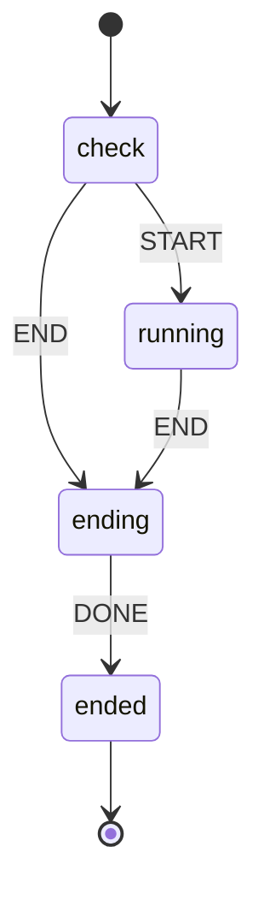
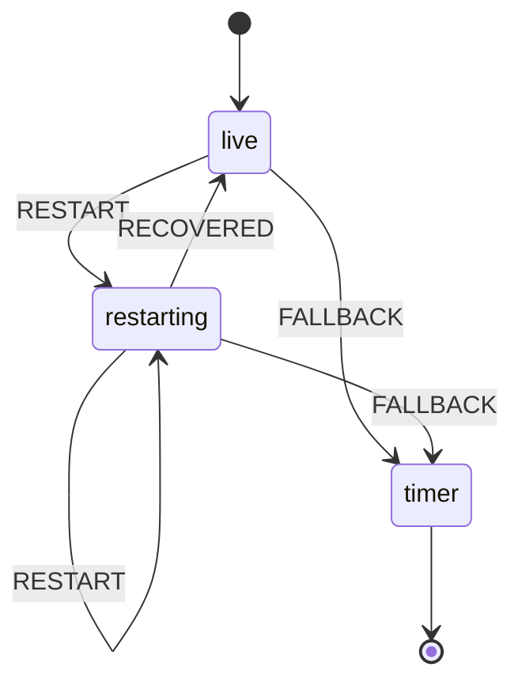
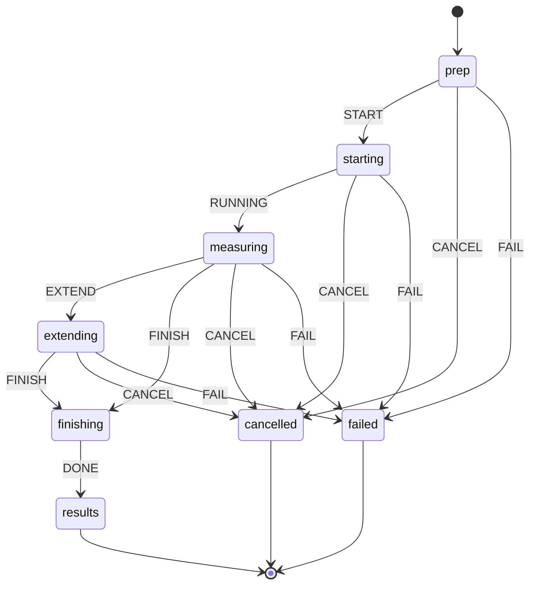

# SOVA state machines

Generated from `shared/core/machines.js` by `npm run docs:machines`. Do not edit by hand.

SOVA keeps every multi-step flow as one named state with declared moves, instead of several booleans that can disagree.
Machines (below) are stored and changed only through `send(EVENT)`; an event the current state does not accept is ignored and logged as `[SOVA] machine <id>: "<EVENT>" ignored in state "<state>"`, so a double click can never start or end something twice.
Derived states (further down) are computed from data on every render and never stored, so they cannot go stale.

Inspect the live state at any time in DevTools with `window.sovaState()`.

## Machines

### Focus session lifecycle (`session`)

Code: `src/renderer/session.js (LiveSession.lifecycle)`. Starts in `check`.

| State | What the person sees | Events → next state |
| --- | --- | --- |
| `check` | Signal check with camera preview (live mode only) | `START` → `running`, `END` → `ending` |
| `running` | Workstation: timer, breath lines, readings | `END` → `ending` |
| `ending` | Wrapping up; waits up to 25 s for the AI reflection if it is on | `DONE` → `ended` |
| `ended` | Reflection, then summary (session record saved) | final |

### Live signal source for a session (`signal`)

Code: `src/renderer/session.js (LiveSession.signal)`. Starts in `live`.

| State | What the person sees | Events → next state |
| --- | --- | --- |
| `live` | Readings from the SmartSpectra SDK | `RESTART` → `restarting`, `FALLBACK` → `timer` |
| `restarting` | "Reconnecting live readings" while the SDK restarts (error retry or lighter camera mode) | `RESTART` → `restarting`, `RECOVERED` → `live`, `FALLBACK` → `timer` |
| `timer` | Plain timer, with the reason shown; no readings for the rest of the session | final |

### 60-second signal check-in (`checkin`)

Code: `src/renderer/checkin.js (CheckIn.machine)`. Starts in `prep`.

| State | What the person sees | Events → next state |
| --- | --- | --- |
| `prep` | Camera preview and setup tips; Start enabled once the preview or a good signal is there | `START` → `starting`, `CANCEL` → `cancelled`, `FAIL` → `failed` |
| `starting` | Measuring screen, "Starting the camera" | `RUNNING` → `measuring`, `CANCEL` → `cancelled`, `FAIL` → `failed` |
| `measuring` | Countdown, breath lines, per-signal quality | `EXTEND` → `extending`, `FINISH` → `finishing`, `CANCEL` → `cancelled`, `FAIL` → `failed` |
| `extending` | "Waiting for HRV", up to 30 s more, with Show results now | `FINISH` → `finishing`, `CANCEL` → `cancelled`, `FAIL` → `failed` |
| `finishing` | Camera released, record saved | `DONE` → `results` |
| `results` | Results with personal range, feeling and next steps | final |
| `failed` | "The check-in couldn't finish" with the reason | final |
| `cancelled` | Back where you were; camera off | final |

## Derived states

### Personal baseline during a session (`baseline`)

Code: `src/renderer/session.js (LiveSession.baselineState())`.

| State | Meaning |
| --- | --- |
| `off` | Timer mode: no baseline |
| `waiting` | No steady breathing or pulse yet; "Waiting for a steady signal" |
| `learning` | Window open, progress bar for 2 minutes; restarts after a reconnect |
| `set` | Reliable baseline; cues on |
| `unreliable` | Baseline could not be set; cues off; Recalibrate shown |

### First launch (a linear wizard: an ordered list of steps, not a machine) (`onboarding`)

Code: `src/renderer/app.js (startOnboarding, showStep, nextStep)`.

| State | Meaning |
| --- | --- |
| `name` | "What should SOVA call you?" (skipped once onboarded) |
| `goals` | "What brings you here?" sets the starting preset and pattern |
| `consent` | Camera consent; only when the consent version is new |
| `done` | Home, or Settings when there is no API key yet; Change goals in Settings runs name and goals only |

### Focus timer phase (`timer`)

Code: `shared/core/sessionEngine.js (SessionEngine)`.

| State | Meaning |
| --- | --- |
| `focus` | Focus block counting down |
| `break` | Break counting down (adaptive length) |
| `paused` | Any pause reason active: manual, away, or a reset/eye rest |
| `done` | All blocks finished |

### Floating widget visibility (`widget`)

Code: `src/main/main.js (syncWidget)`.

| State | Meaning |
| --- | --- |
| `none` | No running session, or the person closed it (until the next session) |
| `hidden` | Session running and the SOVA window is in front |
| `shown` | Session running and you are in another app |

### Breathing reset overlay (time-driven: the phase is computed from elapsed time) (`reset`)

Code: `src/renderer/reset.js (openReset frame loop)`.

| State | Meaning |
| --- | --- |
| `room-check` | First 3 s with the microphone on: measuring room noise, guide waits |
| `guiding` | Phase word, seconds and lavender lines from guideAt(pattern, t); teal lines when breathing is steady |
| `results` | What SOVA heard (microphone) or straight back, once the time is up or End early |

### Breath sound detector (`mic`)

Code: `shared/core/breathSound.js (BreathSoundDetector)`.

| State | Meaning |
| --- | --- |
| `calibrating` | Learning the room noise floor |
| `quiet` | Below the start threshold |
| `breath` | Above it (with hysteresis); a breath sound is being timed |

### Why a cue is held back (`cue`)

Code: `shared/core/cueEngine.js (suppression order)`.

| State | Meaning |
| --- | --- |
| `not-focus` | Breaks and pauses never cue |
| `quiet-hours` | Inside quiet hours |
| `snoozed` | "In flow" pressed |
| `meeting` | Talking detected or Meeting on |
| `away` | No face |
| `cooldown` | Too soon after the last cue |
| `no-baseline` | Baseline not set or unreliable |
